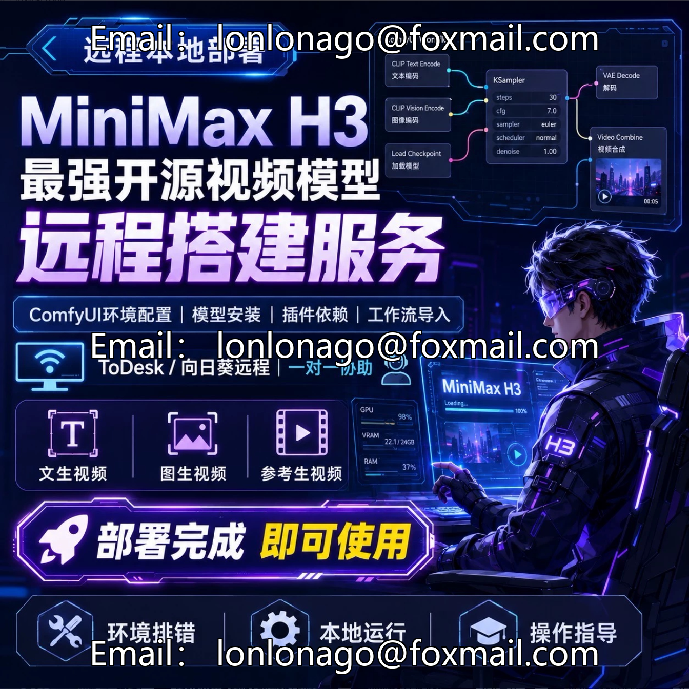
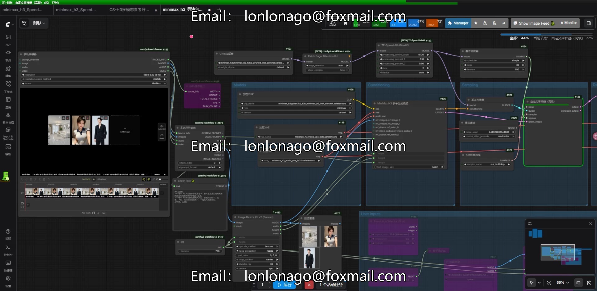
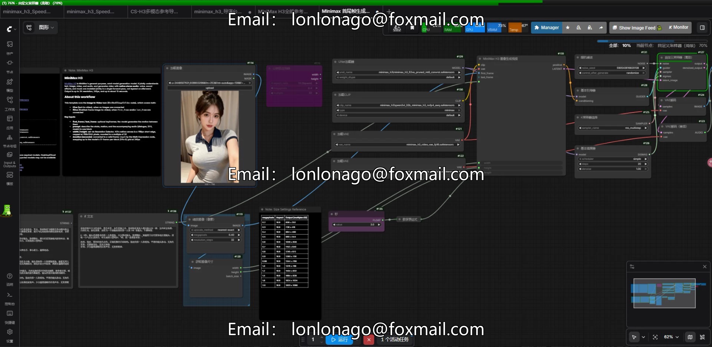
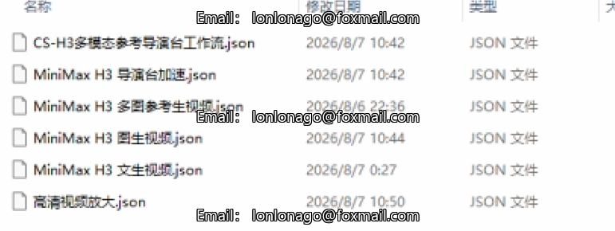

# MiniMax H3 Multimodal Director Remote Local Deployment Service Com

## Body

MiniMax H3 Multimodal Director Remote Local Deployment Service ComfyUI Compatibility Speed Up Generation by 45% No Further Payments | Approximately 108GB in total package compression.

Product Description
Offers a dedicated director's console remote deployment service for the MiniMax H3 clamshell video model. Completing the full process of adaptation and setup based on the ComfyUI interface, the deployment can be used locally offline without any subsequent subscription fees. It is compatible with various content creation scenarios such as short videos by self-media, animation production, and AI short dramas.

Core advantages
Efficiency Upgrade: With the exclusive optimization acceleration plan, the video generation speed is increased by about 45% compared to the native deployment, effectively shortening the filming waiting period.
Visual Director Console Operation: Integrated Multimodal Creative Functions, with a more intuitive reference material import and parameter adjustment process, reducing the barrier to entry for operation.
Local offline operation: All generated computations are completed locally on the device, ensuring privacy control over materials and output data. There is no need for pay-per-use or usage limits, making long-term creation marginal cost low.
Full-featured compatibility: Full support for H3 core capabilities such as text-to-video, image-to-video, and multi-reference generation, matching diverse creative needs.

Service Content
Remotely complete system environment, CUDA dependencies, full configuration and debugging of the operating framework.
Adaptation for deployment of MiniMax H3 director console workflows and functional nodes.
Optimization of ComfyUI interface and full functionality availability verification.
Comprehensive operational guidance to ensure independent operation and use.

Hardware Configuration Requirements
System: Windows 10 and above versions
Memory: 16G or more running memory
Graphics Card: Only supports NVIDIA graphics cards, recommended RTX 3060 or above (12G VRAM); the minimum 8G VRAM can run the quantized version, resulting in a corresponding decrease in generation speed.
AMD graphics cards and Mac devices are not supported.

Service Process
After placing an order, communicate to schedule deployment time.
Perform operations through ToDesk or Sunflower remote tools.
Environment setup, functional deployment, and operational testing completed.
Delivery and Usage, Synchronization Basic Operations Guide

Purchase Notice
This product is a manual remote deployment service, and the related model resources are sourced from official open-source channels. This store only provides environment setup and debugging services.
The service content is replicable. Once completed and confirmed to operate normally, refunds are not supported under any circumstances. Please confirm the hardware configuration meets requirements before placing an order.
The deployment time is subject to the user's local network and hardware environment, with the progress of operations as the reference.
Please comply with the corresponding open-source model license agreements and relevant laws and regulations, and only for personal study and research use. Prohibit illegal commercial use and secondary distribution.

## Images

## Payment

Here is a pay link on Stripe ( https://buy.stripe.com/3cs8yP7sY87d0vu9AB ). Please contact me lonlonago@foxmail.com after funding $89, and I will send you a complete data files , thank you!

